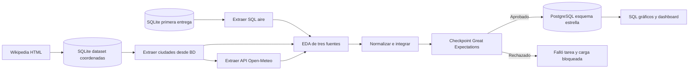
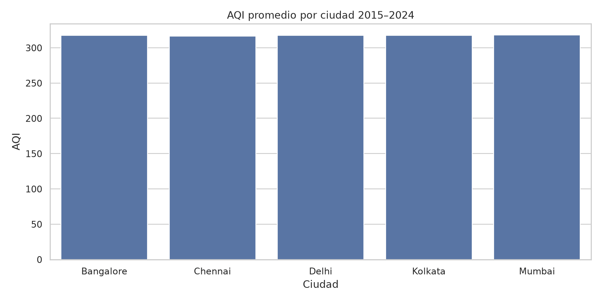
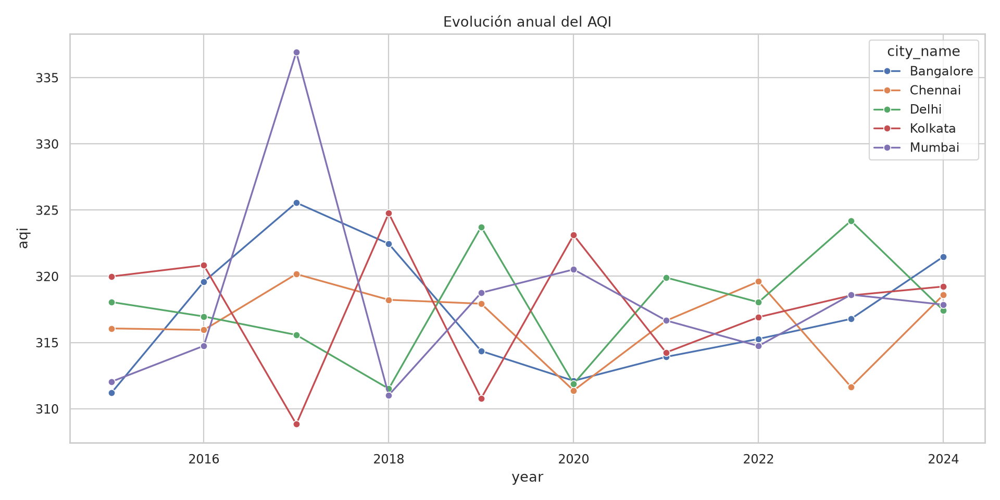
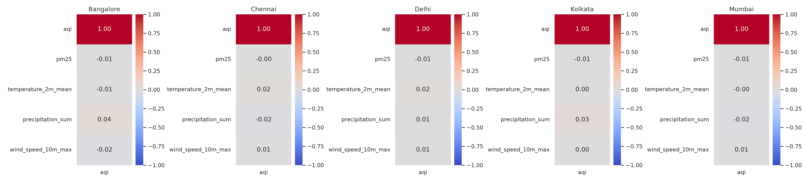

# ETL y análisis de la calidad del aire en India

Este repositorio reúne la primera entrega y su continuación con Airflow, Great Expectations y PostgreSQL. Los archivos de la primera entrega se conservan como base del proyecto.

La segunda entrega está en [el notebook de Colab](notebooks/Segunda_entrega_India_Colab.ipynb). También se puede [abrir directamente en Colab](https://colab.research.google.com/github/santbce/etl_calidadl_aire_india_second_delivery/blob/main/notebooks/Segunda_entrega_India_Colab.ipynb).

El informe inicial y sus figuras están en `report/`. Los resultados de la segunda entrega están en `reports/`, sus diagramas en `docs/` y las pruebas ejecutadas en `evidencias/`.

## Primera entrega

**Integrantes:**  
Samuel Flores  
Santiago Becerra  

---

# Descripción del proyecto

Este proyecto implementa un proceso ETL (Extract, Transform, Load) para analizar la calidad del aire en cinco ciudades de India entre los años 2015 y 2024.

El objetivo principal es transformar datos ambientales en información organizada que permita estudiar el comportamiento del AQI (Air Quality Index), los contaminantes presentes y las condiciones generales de calidad del aire.

El proceso desarrollado incluye:

1. Extracción de datos desde un archivo CSV.
2. Exploración y validación inicial de la información.
3. Transformación de variables y creación de datos temporales.
4. Carga de los datos en una base de datos SQLite.
5. Construcción de un modelo dimensional tipo estrella.
6. Consultas SQL y análisis realizados directamente desde la base de datos.
7. Creación de visualizaciones para interpretar los resultados.

---

# Relación con los Objetivos de Desarrollo Sostenible

El proyecto se relaciona principalmente con los siguientes Objetivos de Desarrollo Sostenible:

## ODS 3: Salud y bienestar

La contaminación atmosférica puede afectar la salud de las personas. El análisis de los niveles del AQI permite identificar condiciones desfavorables de calidad del aire y estudiar la frecuencia de categorías de contaminación.

## ODS 11: Ciudades y comunidades sostenibles

El análisis de información ambiental permite comparar la calidad del aire entre ciudades y comprender algunos de los desafíos ambientales presentes en zonas urbanas.

---

# Fuente de los datos

Los datos fueron obtenidos del siguiente dataset de Kaggle:

AQI Air Quality Data India 2015–2024

https://www.kaggle.com/datasets/sathvikisikella/cleaned-air-quality-india

Archivo utilizado:

Air_quality_data.csv

Características principales del dataset:

- 18.265 registros.
- 13 variables originales.
- Información desde 2015 hasta 2024.
- Cinco ciudades:
  - Delhi
  - Mumbai
  - Chennai
  - Kolkata
  - Bangalore

Variables principales:

- PM2.5
- PM10
- NO
- NO2
- NOx
- NH3
- CO
- SO2
- O3
- AQI
- AQI_Bucket

---

# Arquitectura del proyecto

El flujo implementado corresponde a una arquitectura ETL:

Archivo CSV

↓

Extracción con Python

↓

Validación y transformación de datos

↓

Base de datos SQLite

↓

Modelo dimensional estrella

↓

Consultas SQL

↓

Visualizaciones y análisis

---

# Estructura del proyecto

etl-calidad-aire-india/

├── data/

│   └── raw/

│       └── Air_quality_data.csv

├── database/

│   └── air_quality.db

├── notebooks/

│   ├── 01_exploracion_inicial.ipynb

│   └── 02_analisis_desde_bd.ipynb

├── src/

│   ├── etl.py

│   └── cargar_modelo_dimensional.py

├── sql/

│   └── schema.sql

├── report/

│   ├── informe_tecnico.md

│   └── figuras/

├── requirements.txt

└── README.md

---

# Tecnologías utilizadas

## Python

Utilizado para desarrollar el proceso ETL, transformación y procesamiento de datos.

## Pandas

Utilizado para lectura, limpieza y transformación del dataset.

## NumPy

Utilizado para operaciones numéricas.

## SQLite

Utilizado como base de datos relacional para almacenar los datos procesados.

## SQL

Utilizado para crear consultas, organizar la información y construir el modelo dimensional.

## Jupyter Notebook

Utilizado para exploración de datos, análisis y generación de resultados.

## Matplotlib y Seaborn

Utilizados para crear las visualizaciones del análisis.

## Git y GitHub

Utilizados para control de versiones y almacenamiento del proyecto.

---

# Modelo dimensional

El proyecto implementa un modelo estrella compuesto por:

## Tabla de hechos

### fact_air_quality

Contiene las mediciones principales:

- PM2.5
- PM10
- NO
- NO2
- NOx
- NH3
- CO
- SO2
- O3
- AQI

## Tablas de dimensiones

### dim_city

Contiene la información de las ciudades analizadas.

### dim_date

Contiene la información temporal:

- año
- mes
- día
- trimestre
- día de la semana

### dim_aqi

Contiene las categorías de calidad del aire.

---

# Instalación

Clonar el repositorio:

git clone https://github.com/santbce/etl-calidad-aire-india.git

Ingresar a la carpeta del proyecto:

cd etl-calidad-aire-india

Instalar las dependencias:

pip install -r requirements.txt

---

# Ejecución del proyecto

## 1. Ejecutar proceso ETL

python src/etl.py

Este proceso realiza:

- Lectura del archivo CSV.
- Validación de datos.
- Transformación de fechas.
- Creación de variables temporales.
- Carga de información en SQLite.

---

## 2. Crear modelo dimensional

python src/cargar_modelo_dimensional.py

Este proceso genera:

- dim_city
- dim_date
- dim_aqi
- fact_air_quality

---

## 3. Ejecutar análisis

Los análisis se encuentran en:

notebooks/01_exploracion_inicial.ipynb

notebooks/02_analisis_desde_bd.ipynb

Las consultas y visualizaciones utilizan los datos almacenados en la base de datos SQLite.

---

# Análisis realizado

Durante el proyecto se realizaron:

- Revisión de estructura del dataset.
- Identificación de valores nulos.
- Detección de registros duplicados.
- Validación de fechas.
- Estadísticas descriptivas.
- Distribución de categorías AQI.
- Comparación del AQI entre ciudades.
- Evolución temporal del AQI.
- Correlación entre contaminantes.
- Análisis de distribución mediante diagramas de caja.

---

# Resultados principales

Los principales resultados obtenidos fueron:

- AQI promedio general aproximado de 317.51.
- Las categorías más frecuentes fueron Very Poor y Severe.
- Las ciudades presentan valores promedio de AQI similares.
- PM10 presentó la mayor relación con el AQI, aunque con una correlación débil.
- La mayoría de registros representan condiciones poco favorables de calidad del aire.

---

# Limitaciones

- El dataset no especifica todas las unidades de medida de las variables.
- Los datos provienen de Kaggle y presentan una estructura previamente organizada.
- Las correlaciones encontradas representan asociaciones y no causalidad.
- El análisis solo incluye cinco ciudades de India.

---

# Autores

Samuel Flores  
Santiago Becerra

---

# Actualización del proyecto: segunda entrega

[abrir notebook en colab](https://colab.research.google.com/github/santbce/etl_calidadl_aire_india_second_delivery/blob/main/notebooks/Segunda_entrega_India_Colab.ipynb)

## Segunda entrega de calidad del aire en India

Samuel Flores y Santiago Becerra. curso etl g51.

Continuamos el proyecto de la primera entrega sobre aqi y contaminantes en bangalore, chennai, delhi, kolkata y mumbai. lo que queremos revisar es como se relacionan temperatura, precipitación y viento con aqi y pm2.5 por ciudad y periodo, conservando las 18.265 mediciones de 2015–2024. estas comparaciones nos muestran asociaciones; no demuestran que el clima cause los cambios del aqi. la relación temática se mantiene con ods 3 y ods 11.

## Cómo ejecutar la segunda entrega en Colab

Abre `Segunda_entrega_India_Colab.ipynb` en google colab. ejecuta las celdas en orden. carga el zip original `etl-calidad-aire-india-main.zip` o léelo desde la carpeta `second delivery` en tu drive. el notebook incluye el código completo y genera los archivos de este repositorio. no requiere docker.

Se usa un entorno aislado de python 3.12 con airflow 2.11.2 y los constraints oficiales, siguiendo `airflow_intro.ipynb` y `airflow_gx.ipynb` del profesor. gx utiliza el mismo patrón suite → data source → asset → batch definition → validation definition → checkpoint de s8. usamos gx 1.24.0 para repetir las pruebas con la misma version.

Colab instala postgresql dentro de la sesión linux. la primera entrega y las coordenadas siguen en sqlite como fuentes. el warehouse final está en postgresql, de acuerdo con el stack solicitado en la segunda entrega. se crea un esquema dedicado `india_dw`; ninguna tarea escribe en la base original.

## Fuentes de datos adicionales

1. primera entrega: `primera_entrega/database/air_quality.db`, procedente de kaggle [aqi air quality data india 2015–2024](https://www.kaggle.com/datasets/sathvikisikella/cleaned-air-quality-india). se extraen desde sql solo identificadores, ciudad, fecha, categoría y contaminantes del periodo requerido.

2. dataset adicional: coordenadas de las cinco páginas de ciudades en wikipedia. se extrae la coordenada principal del artículo usando `requests` y `BeautifulSoup`, se conserva el html y se carga en `data/cities.sqlite`. la tarea del dag extrae desde la tabla `city_coordinates`. aporta cinco registros y se relaciona muchos a uno con las mediciones. este es un dataset geográfico pequeño, no una segunda serie de mediciones.

3. api pública: [historical weather api de open-meteo](https://open-meteo.com/en/docs/historical-weather-api), endpoint `https://archive-api.open-meteo.com/v1/archive`. consultas ciudad/año, modelo era5, zona `Asia/Kolkata`, temperatura media diaria en °c, precipitación diaria en mm y viento máximo diario a 10 m en m/s. se conservan coordenadas solicitadas y coordenadas de la celda devueltas. la fuente es reanálisis, no una estación meteorológica específica. la caché guarda parámetros, url, json y fecha utc de extracción. se reutiliza hasta 24 horas, de forma explícita en la procedencia.

## Objetivos de la segunda entrega

- comparar aqi por ciudad y evolución anual/mensual.

- explorar las asociaciones de aqi y pm2.5 con las tres variables del clima por ciudad; evitar confundir diferencias entre ciudades con una asociación global.

- conservar las 18.265 combinaciones ciudad/día, sin duplicar ni descartar registros válidos.

- bloquear publicación ante nulos, claves duplicadas, fechas fuera del periodo, valores negativos o falta de coincidencia meteorológica.

- obtener gráficos únicamente desde filas aprobadas y cargadas en postgresql.

## Arquitectura y DAG de Airflow

El dag `etl_calidad_aire_india_enriquecido` usa `with DAG`, `PythonOperator` y dependencias `>>`, igual que los ejemplos de clase. se programa cada día, con `catchup=False` y `max_active_runs=1`. la primera extracción y las coordenadas pueden ejecutarse independientemente. la api espera las coordenadas. eda, merge, validación, carga y visualización siguen en ese orden.

Se detiene la tarea de validación con una excepción si falla el checkpoint. la regla por defecto `all_success` impide ejecutar carga y visualización. se escogió este flujo en vez del branching de demostración porque la carga es real y un lote inválido debe dejar la ejecución fallida. 

## Análisis exploratorio y transformación

El notebook genera tipos, nulos, duplicados de fila y de clave, frecuencias, estadísticas, iqr e histogramas para las tres fuentes antes de publicar. los resultados se guardan por ejecución en `data/runs/<run_id>/eda_sources.json`. el notebook ejecutado muestra estas tablas e incluye la interpretación de los resultados.

Se convierte la fecha a iso y las medidas a numérico. las claves de ciudad provienen de la base original. se unen coordenadas por `city_id` con `validate='many_to_one'` y clima por `city_id,date` con `validate='one_to_one'`, conservando todas las filas con `left join`. los registros sin clima se documentan y detienen el lote. no se imputan datos meteorológicos, no se convierten nulos en cero ni se eliminan outliers solo por iqr. no se inventan unidades de contaminantes que el dataset no documenta.

Las fechas originales se interpretan como días locales de india. es una hipótesis explícita porque la fuente no documenta la zona horaria; requiere revisión con la documentación del dataset antes de interpretar asociaciones diarias como equivalentes exactas. la categoría aqi se conserva; no se recalcula con umbrales de otra escala.

## Validación de calidad con Great Expectations

Revisamos el conteo exacto, campos obligatorios no nulos, identificador único, unicidad compuesta ciudad/fecha, ciudades y categorías permitidas, fechas del periodo, rangos geográficos, contaminantes/aqi/lluvia/viento finitos y no negativos y un rango físico amplio de temperatura. un control adicional compara el conjunto completo de las cinco ciudades y los 3.653 días esperados.

Se guardan `expectation_suite.json`, `validation.json` y una aprobación con sha-256 del csv validado. la carga verifica que el lote no haya cambiado desde la aprobación. una validación anterior no habilita un archivo modificado. guardamos el resultado del checkpoint para revisar cada validacion.

## Modelo dimensional y carga en PostgreSQL

Cada fila de la tabla de hechos corresponde a una ciudad y un dia. `fact_air_quality` mantiene mediciones originales y clima. las dimensiones son `dim_city` (coordenadas y procedencia), `dim_date` (día/calendario) y `dim_aqi` (categorías). la vista `air_quality_enriched` reconstruye el dataset enriquecido. `etl_runs` registra la ejecución y su validación.

Postgresql aplica pk, fk, unique y check. se reemplaza el lote dentro de una sola transacción: fallos revierten la carga, reejecutar no acumula mediciones. es una instantánea histórica, no una carga incremental de datos actuales. la programación diaria renueva la extracción y comprueba el lote, sin afirmar que el csv histórico crece.

## ostramos los resultados y las pruebas

Las figuras y el dashboard se generan leyendo únicamente `india_dw.air_quality_enriched` tras la carga. incluyen promedio de aqi por ciudad, distribuciones del clima, evolución anual y correlaciones por ciudad. `findings.json`, `monthly.csv` y `correlations_by_city.csv` permiten comprobar cifras. las conclusiones de la ejecución se presentan en `docs/resultados_ejecucion.md`.

Probamos la orquestacion ejecutando `airflow dags test` y consultamos `dag_run` y `task_instance` en la base de metadatos. después iniciamos scheduler/webserver para observar el dag. la prueba deliberada introduce precipitación negativa en un lote separado: gx debe rechazarlo y el lote del warehouse debe conservarse. el notebook descarga el código, reportes y un dump postgresql al terminar.

## Exportación y reproducción

Airflow puede programar ejecuciones mientras el runtime de colab permanece activo. colab no garantiza un servicio diario permanente y al terminar la sesión pueden desaparecer el entorno y las bases. por eso se exportan resultados y dump al drive. para operación continua futura habría que alojar el mismo dag en un servidor persistente; docker no es necesario para esta práctica.

El notebook completo se ejecutó en colab. la interpretación, los estados de las nueve tareas, el fallo deliberado y la comprobación de idempotencia están incluidos en esta entrega. el repositorio público contiene el código y las evidencias. la entrega al profesor se realiza mediante el enlace o los archivos según la plataforma del curso.

## Relación con las prácticas de clase

| material | uso en la implementación |

|---|---|

| s6 extracción y notebooks | sqlite, consulta sql, `requests`, `BeautifulSoup`, json, timeout, retry y merge |

| ingesta_multiple_practica | contratos de entrada, cardinalidad, procedencia y fallo deliberado |

| airflow airflow_intro | python 3.12 aislado, airflow 2.11.2, pythonoperator, dag, `dags test` |

| airflow airflow_retries | distinguir fallos temporales de contrato |

| s8 gx y airflow_gx | suite, asset, lote, validationdefinition, checkpoint y bloqueo de carga |

## Referencias de la segunda entrega

- consigna proporcionada: project second delivery, cinco páginas.

- propuesta del equipo: diseño de extracción y orquestación para la calidad del aire en india.

- [documentación de open-meteo](https://open-meteo.com/en/docs/historical-weather-api).

- [dags de apache airflow](https://airflow.apache.org/docs/apache-airflow/2.11.0/core-concepts/dags.html).

- [gx data context](https://docs.greatexpectations.io/docs/core/set_up_a_gx_environment/create_a_data_context/).

## Archivos incorporados en la segunda entrega

`data/etl-calidad-aire-india-main.zip`: proyecto original sin cambios; el notebook lo extrae en `primera_entrega/` durante la ejecución. `src/`: funciones python. `dags/`: orquestación. `sql/`: ddl postgresql. `data/`: zip original; las fuentes adicionales, caché y lotes se generan al ejecutar el notebook. `reports/`: dashboard y hallazgos desde warehouse. `notebooks/`: notebook colab. `tests/`: pruebas de protección de carga.

## Resultados de la ejecución

El dag completo termino con nueve tareas exitosas. se validaron 18.265 mediciones, la carga invalida quedo bloqueada y se comprobo idempotencia. ver [informe de resultados](docs/resultados_ejecucion.md), [diagramas](docs/diagramas.md), [comprobaciones](evidencias/comprobaciones.json) y [estados de airflow](evidencias/airflow_task_states.csv). el zip de la primera entrega esta en data para reproducir la ejecucion.

## Cómo repetir las pruebas de carga

Después de ejecutar el notebook, establece `INDIA_PROJECT_ROOT` con la carpeta del proyecto y ejecuta `python -m unittest discover -s tests`. la prueba usa el último lote aprobado; `INDIA_TEST_RUN_ID` permite seleccionar uno. comprueba el rechazo de precipitación negativa y de un csv modificado después de aprobarlo. sin un lote previo, informa que la prueba se omite.

## Comprobación final

Las 42 comprobaciones aprobaron en colab el 13 de octubre de 2026 (hora de colombia). incluyen respuestas de api, uniones, once lotes invalidos, restricciones de postgresql, recarga sin duplicados, conciliacion con el csv, graficos, servicios y restauracion del dump. ver [auditoria completa](evidencias/auditoria_completa.json), [ejecucion diaria](evidencias/scheduler_run.json) y [prueba manual final](evidencias/manual_run.json). el scheduler diario y la prueba manual terminaron con nueve tareas exitosas cada uno.

Para repetir la auditoria completa, ejecuta `tests/auditoria_colab.py` con el python del entorno de airflow despues del notebook. necesita `INDIA_PROJECT_ROOT`, `INDIA_DATABASE_URL`, `INDIA_SOURCE_ZIP` y `AIRFLOW_HOME`, ademas del lote aprobado y la evidencia del scheduler. la celda de auditoria configura la ruta del zip.

